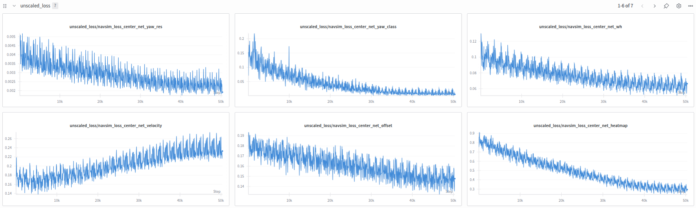

# Обучение

Это руководство описывает локальное обучение модели для CARLA Leaderboard.

```{note}
Этот материал относится к обучению политик для CARLA Leaderboard. Для кросс-датасетного обучения (NAVSIM, Waymo) см. [кросс-датасетное обучение](cross_dataset_training.md).
Для крупномасштабного обучения на HPC-кластерах см. [руководство по обучению через SLURM](slurm_training.md).
```

## Предварительные требования

Следующие шаги нужно выполнить один раз для каждого датасета.

### Подготовка данных

На этом шаге предполагается, что вы либо

1. Следовали [руководству по сбору данных](data_collection.md), чтобы собрать данные локально

2. Либо скачали данные с [Hugging Face](https://huggingface.co/datasets/ln2697/lead).

В любом случае структура данных должна соответствовать следующей:

```{code-block}
:emphasize-lines: 2,3,4

data/carla_leaderboard2
├── data
│   └── BlockedIntersection
│       └── 999_Rep-1_Town06_13_route0_12_22_22_34_45
```

### Построение бакетов данных

Бакеты группируют обучающие сэмплы по характеристикам (сценарии, города, погода, кривизна дороги и т. д.), что позволяет использовать curriculum learning и сбалансированный sampling батчей.

Коллекции бакетов по умолчанию:
- **Предобучение**: [lead/data_buckets/full_pretrain_bucket_collection.py](https://github.com/kesai-labs/lead/blob/main/lead/data_buckets/full_pretrain_bucket_collection.py) равномерно сэмплирует все доступные данные
- **Постобучение**: [lead/data_buckets/full_posttrain_bucket_collection.py](https://github.com/kesai-labs/lead/blob/main/lead/data_buckets/full_posttrain_bucket_collection.py) отфильтровывает начальные и финальные сэмплы каждой последовательности (они могут содержать артефакты инициализации) и равномерно сэмплирует оставшиеся данные

Бакеты строятся один раз, сохраняются на диск и автоматически переиспользуются в последующих запусках.

Постройте бакеты для предобучения:

```bash
python3 scripts/build_buckets_pretrain.py
```

Постройте бакеты для постобучения:

```bash
python3 scripts/build_buckets_posttrain.py
```

Ожидаемая структура выходных данных:

```{code-block}
:emphasize-lines: 2,3,4

data/carla_leaderboard2
├── buckets
│   ├── full_posttrain_buckets_8_8_8_5.gz
│   └── full_pretrain_buckets.gz
├── data
│   └── BlockedIntersection
│       └── 999_Rep-1_Town06_13_route0_12_22_22_34_45
```

Файлы бакетов используют относительные пути и переносимы между машинами.

```{note}
Бакеты содержат только те сэмплы данных, которые были доступны на момент построения. Перестройте бакеты после добавления или удаления маршрутов.
```

```{note}
Если после крупных изменений кода возникают ошибки, которые трудно отлаживать, попробуйте удалить бакеты и построить их заново.
```

### Построение постоянного кэша данных

Сырые данные сенсоров (изображения, LiDAR, RADAR) требуют предобработки — декомпрессии, преобразования форматов и временного выравнивания. Обучающий кэш хранит предобработанные сжатые данные на диске, устраняя лишние вычисления и ускоряя загрузку данных. После построения кэш переиспользуется во всех обучающих запусках.

Два типа кэша:

- **`persistent_cache`**: хранится рядом с датасетом и переиспользуется во всех обучающих сессиях. См. [PersistentCache](https://github.com/kesai-labs/lead/blob/main/lead/data_loader/training_cache.py)
- **`training_session_cache`**: временный кэш на локальном SSD во время кластерных задач, реализованный через [diskcache](https://pypi.org/project/diskcache/). В первые несколько эпох данные загружаются с общего хранилища и кэшируются на локальном SSD задачи для более быстрого последующего доступа. Эта реализация специфична для SLURM-кластера нашей организации.

Постройте постоянный кэш:

```bash
python3 scripts/build_cache.py
```

Ожидаемая структура выходных данных:

```{code-block}
:emphasize-lines: 5,6,7

data/carla_leaderboard2
├── buckets
│   ├── full_posttrain_buckets_8_8_8_5.gz
│   └── full_pretrain_buckets.gz
├── cache
│   └── BlockedIntersection
│       └── 999_Rep-1_Town06_13_route0_12_22_22_34_45
├── data
│   └── BlockedIntersection
│       └── 999_Rep-1_Town06_13_route0_12_22_22_34_45
```

Кэш обучающей сессии в первые несколько эпох обучения загружается с общего диска и сохраняется на диск обучающей сессии. Эта реализация специфична для SLURM-кластеров нашей организации.

```{note}
Перестройте кэш после изменения data pipeline (например, после добавления новых семантических классов или изменения шагов предобработки).
```

## Предобучение восприятия

Следуя стандартным процедурам обучения в стиле TransFuser, обучение проходит в две фазы: сначала обучается только perception backbone, затем вся модель обучается end-to-end.

```bash
python3 lead/training/train.py logdir=outputs/local_training/pretrain
```

Если обучать только на одном маршруте, обучение занимает примерно 1–2 минуты и создает:

```
outputs/local_training/pretrain
├── config.json
├── events.out.tfevents.1764250874.local.105366.0
├── gradient_steps_skipped_0030.txt
├── model_0030.pth
├── optimizer_0030.pth
├── scaler_0030.pth
└── scheduler_0030.pth
```

Скрипт обучения создает логи WandB/TensorBoard и изображения визуализации в `outputs/training_viz`. Частотой логирования можно управлять через `log_scalars_frequency` и `log_images_frequency` в [lead/training/config_training.py](https://github.com/kesai-labs/lead/blob/main/lead/training/config_training.py).

Логирование изображений выполняется как минимум один раз за эпоху и может быть дорогим. Отключите его, задав `visualize_training=false` в конфиге.

Просматривайте логи обучения с помощью [TensorBoard](https://www.tensorflow.org/tensorboard):

```bash
tensorboard --logdir outputs/local_training/pretrain
```

Также поддерживается логирование в [WandB](https://wandb.ai). Включите его, задав `log_wandb=true` в конфиге обучения.



## Постобучение планирования

```{note}
Во время постобучения счетчик эпох сбрасывается на 0. Состояние оптимизатора инициализируется заново, потому что planner не был включен в checkpoint предобучения.
```

После завершения предобучения продолжите постобучение, чтобы добавить planner и обучить полную модель end-to-end:

```bash
python3 lead/training/train.py logdir=outputs/local_training/posttrain load_file=outputs/local_training/pretrain/model_0030.pth use_planning_decoder=true
```

## Возобновление неудачного обучения

Чтобы продолжить прерванный обучающий запуск, задайте `continue_failed_training=true` в конфиге обучения.

## Распределенное обучение

(Возможно не работает)

Pipeline поддерживает [Torch DDP](https://docs.pytorch.org/docs/stable/generated/torch.nn.parallel.DistributedDataParallel.html). См. примеры скриптов:
- [scripts/pretrain_ddp.sh](https://github.com/kesai-labs/lead/blob/main/scripts/pretrain_ddp.sh)
- [scripts/posttrain_ddp.sh](https://github.com/kesai-labs/lead/blob/main/scripts/posttrain_ddp.sh)

## Распространенные проблемы

### Сервер CARLA работает в фоне

Может возникнуть такая ошибка:

```bash
RuntimeError: cuDNN error: CUDNN_STATUS_INTERNAL_ERROR
```

Обычно это означает, что сервер CARLA потребляет VRAM в фоне. Завершите все процессы CARLA:

```bash
bash scripts/clean_carla.sh
```

### Неизвестный корневой путь CARLA: \<carla_root>

Зарегистрируйте конфигурацию вашего датасета CARLA в функции `target_dataset` в [lead/training/config_training.py](https://github.com/kesai-labs/lead/blob/main/lead/training/config_training.py). Сопоставьте корневой путь CARLA с подходящей конфигурацией датасета, которая задает ожидаемую конфигурацию сенсоров и формат данных.

**Зачем такая архитектура?** Она позволяет запускать обучающие эксперименты и одновременно собирать данные с другими конфигурациями сенсоров. `target_dataset` в [lead/expert/config_expert.py](https://github.com/kesai-labs/lead/blob/main/lead/expert/config_expert.py) управляет тем, какие сенсоры установлены на экспертном автомобиле во время сбора данных.
