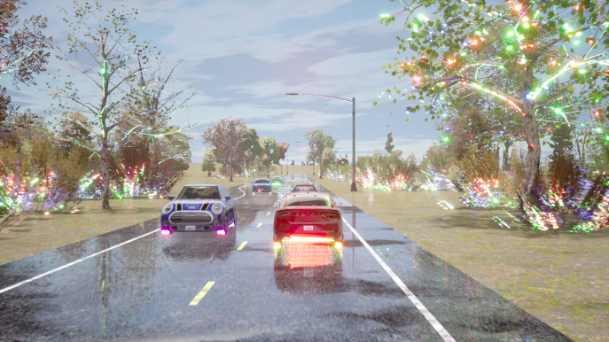

# Оценка

Это руководство описывает локальную оценку для быстрого старта. Для крупномасштабной оценки (запуск множества маршрутов параллельно) см. [руководство по оценке через SLURM](slurm_evaluation.md).

```{note}
Для оценки в CARLA скачивать датасет не требуется — нужен только checkpoint обученной модели.
```

```{important}
LEAD должен быть установлен как пакет в вашем Python-окружении. Перед запуском оценки убедитесь, что вы находитесь в правильном окружении.
```

## Обзор

Руководство [Quick Start](https://github.com/kesai-labs/lead?tab=readme-ov-file#quick-start) показывает оценку обученной политики на одном маршруте Bench2Drive. Мы предоставляем единый Python-интерфейс оценки (`lead`), который упрощает отладку и конфигурацию для трех самых популярных бенчмарков:

- **Bench2Drive**: подробности бенчмарка см. в [официальном репозитории](https://github.com/Thinklab-SJTU/Bench2Drive)
- **Longest6 v2**: подробности бенчмарка см. в [carla_garage](https://github.com/autonomousvision/carla_garage?tab=readme-ov-file#longest6-v2)
- **Town13**: см. [валидационные маршруты CARLA Leaderboard 2.0](https://github.com/autonomousvision/carla_garage?tab=readme-ov-file#carla-leaderboard-20-validation-routes)

```{warning}
Не оценивайте маршруты Longest6 v2 или Town13 с помощью оценочного репозитория Bench2Drive — определения метрик отличаются.
```

## Запуск оценки

### Предварительные требования

1. **Активируйте Python-окружение**, где установлен LEAD
2. **Запустите сервер CARLA**:

```bash
bash scripts/start_carla.sh
```

### Прямой запуск через Python

Самый простой способ запустить оценку — напрямую через Python:

**Оценка модели (Longest6/Town13):**
```bash
python -m lead \
    --checkpoint outputs/model_0011/config_dual_front_camera.json \
    --routes data/benchmark_routes/Town13/0.xml
```

**Bench2Drive:**
```bash
python -m lead \
    --checkpoint outputs/model_0011/config_dual_front_camera.json \
    --routes data/benchmark_routes/bench2drive/23687.xml \
    --bench2drive
```

**Режим эксперта (генерация данных):**
```bash
python -m lead \
    --expert \
    --routes data/data_routes/lead/noScenarios/short_route.xml
```

### Параметры конфигурации

Поведение оценки управляется через [config_closed_loop.py](https://github.com/kesai-labs/lead/blob/main/lead/inference/config_closed_loop.py). Ключевые настройки:

- `produce_demo_video` — генерировать видео с визуализацией bird's-eye view
- `produce_debug_video` — генерировать подробные отладочные видео с данными сенсоров
- `produce_demo_image` — сохранять отдельные demo-кадры
- `produce_debug_image` — сохранять отдельные debug-кадры

Отключите генерацию видео для более быстрой оценки:

```bash
export LEAD_CLOSED_LOOP_CONFIG="produce_demo_video=false produce_debug_video=false produce_demo_image=false produce_debug_image=false"
```

Переменная окружения `LEAD_CLOSED_LOOP_CONFIG` позволяет переопределять конфигурацию для отдельного запуска без изменения файла конфигурации.

### Структура выходных данных

Каждый запуск оценки создает:

```
outputs/local_evaluation/<route_id>/
├── checkpoint_endpoint.json      # Метрики и результаты Leaderboard 2.0
├── metric_info.json              # Расширенные метрики Bench2Drive (только Bench2Drive)
├── demo_images/                  # Кадры bird's-eye view
├── debug_images/                 # Кадры отладочной визуализации
├── <route_id>_demo.mp4          # Видео bird's-eye view
├── <route_id>_debug.mp4         # Отладочное видео с данными сенсоров
└── debug_checkpoint/             # Отладочные checkpoints
```

## Сводка результатов

### Longest6 v2 и Town13

После завершения всех маршрутов агрегируйте результаты с помощью [парсера результатов](https://github.com/kesai-labs/lead/blob/main/scripts/tools/result_parser.py):

**Longest6 v2:**
```bash
python3 scripts/tools/result_parser.py \
    --xml data/benchmark_routes/longest6.xml \
    --results <directory_with_route_jsons>
```

**Town13:**
```bash
python3 scripts/tools/result_parser.py \
    --xml data/benchmark_routes/Town13.xml \
    --results <directory_with_route_jsons>
```

Он создает итоговый CSV, содержащий:
- Driving score (DS)
- Процент завершения маршрута (RC)
- Разбивку нарушений (столкновения, нарушения ПДД, красные светофоры и т. д.)
- Статистику на километр

### Bench2Drive

Bench2Drive предоставляет расширенные метрики сверх стандартных метрик Leaderboard 2.0. См. [официальное руководство по оценке](https://github.com/Thinklab-SJTU/Bench2Drive?tab=readme-ov-file#eval-tools).

Инструменты оценки Bench2Drive находятся в [3rd_party/Bench2Drive/tools/](https://github.com/kesai-labs/lead/blob/main/3rd_party/Bench2Drive/tools/).

## Лучшие практики

### 1. Настройка окружения

Всегда запускайте оценку при следующих условиях:
- LEAD установлен как пакет в активном Python-окружении
- Опционально: переменная окружения `LEAD_PROJECT_ROOT` указывает на корень вашего workspace
- Сервер CARLA запущен на ожидаемом порту (по умолчанию: 2000)


При достаточных вычислительных ресурсах (16–32 GPU GTX 1080 Ti):
- **Longest6 v2**: ~1 день для 3 seed (36 маршрутов × 3 = 108 оценок)
- **Town13**: ~2 дня для 3 seed (20 маршрутов × 3 = 60 оценок)

Примерно 90% маршрутов завершаются в течение нескольких часов. Отключите генерацию видео/изображений, чтобы ускорить оценку.

### 2. Перезапускайте CARLA между маршрутами

Запуск нескольких маршрутов на одном экземпляре CARLA может вызвать ошибки рендеринга (пример из статьи Bench2Drive):



Перезапускайте CARLA между маршрутами:

```bash
bash scripts/clean_carla.sh  # Завершить процессы CARLA
bash scripts/start_carla.sh  # Запустить новый экземпляр
```


По умолчанию pipeline загружает все три checkpoint seed как ансамбль. Если памяти GPU недостаточно, временно переименуйте два файла checkpoint, чтобы загружался только один seed.

### 3. Используйте правильные инструменты оценки

- **Longest6 v2 и Town13**: оценивайте через стандартную настройку leaderboard
- **Bench2Drive**: необходимо оценивать через [код Bench2Drive](https://github.com/kesai-labs/lead/tree/main/3rd_party/Bench2Drive), иначе результаты будут недействительными

### 4. Учитывайте вариативность оценки

CARLA сильно стохастична даже при фиксированных seeds. Результаты различаются между запусками из-за случайности трафика и недетерминированных факторов симуляции.

**Рекомендуемые протоколы оценки:**
- **Минимум (стандартная практика)**: обучить 3 модели с разными seeds, оценить каждую один раз → всего 3 оценочных запуска
- **Оптимум (для публикаций)**: обучить 3 модели с разными seeds, оценить каждую 3 раза → всего 9 оценочных запусков

Наша исследовательская группа использует минимальный протокол.
