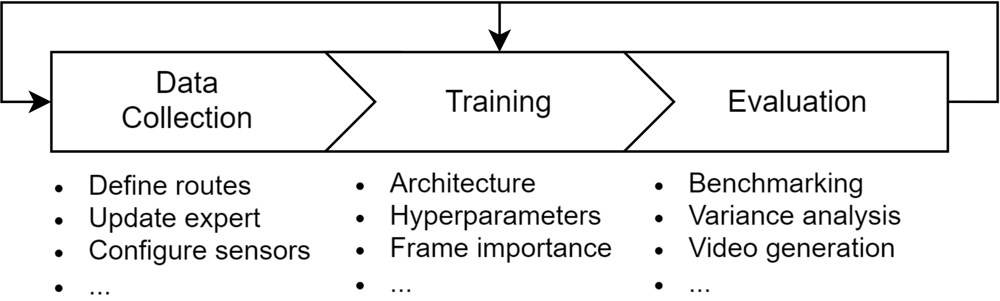

Документация
============

.. note::
   Эта документация поддерживается по мере возможности. Если вы найдете несоответствия или проблемы, сообщите о них в нашем issue tracker.

Документация разделена на три раздела.
**Базовый:** краткие руководства для быстрого старта.
**SLURM:** инфраструктура для крупномасштабных экспериментов.
**Подробно:** детали, которые не нужны сразу, но могут понадобиться позже.

Базового раздела достаточно, чтобы начать локальный цикл сбора данных, обучения и оценки.

|

.. toctree::
   :maxdepth: 2
   :caption: Базовый
   :numbered:

   data_collection
   run_commands
   carla_training
   evaluation
   jupyter_notebooks

.. toctree::
   :maxdepth: 2
   :caption: SLURM
   :numbered:

   slurm_overview
   slurm_data_collection
   slurm_training
   slurm_evaluation

.. toctree::
   :maxdepth: 1
   :caption: Подробно
   :numbered:

   cross_dataset_training
   config_system
   inspecting_pickle_files
   carla_typing_stubs

.. toctree::
   :maxdepth: 1
   :caption: Разное
   :numbered:

   project_structure
   external_resources
   faq
   glossary
   known_issues
