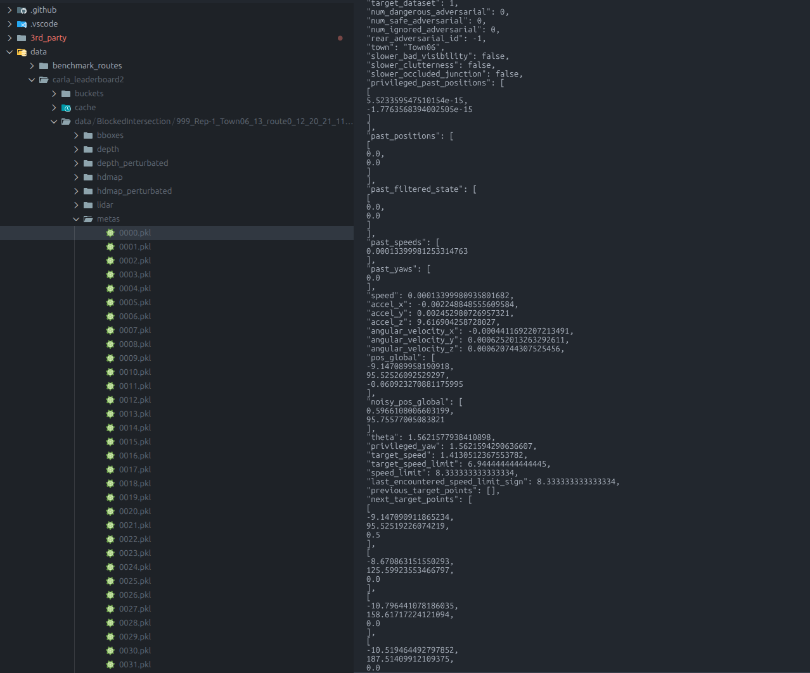

# Просмотр pickle-файлов

Мы сжимаем и храним метаданные с помощью lzma и pickle. Эмпирически это позволяет экономить большую часть памяти.

Чтобы удобно просматривать pickle-данные в VSCode, мы рекомендуем [vscode-pydata-viewer](https://marketplace.visualstudio.com/items?itemName=Percy.vscode-pydata-viewer) и этот скрипт: [3rd_party/vscode_pydata_viewer/view_pickles.py](https://github.com/kesai-labs/lead/blob/main/3rd_party/vscode_pydata_viewer/view_pickles.py). Вместе они позволяют просматривать pickle-файлы напрямую в VSCode.

